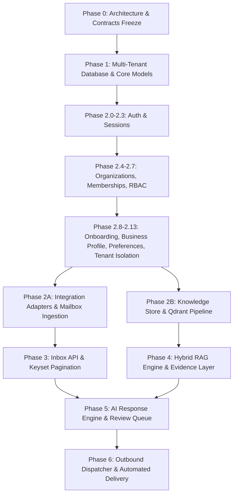

# ProxiPilot Backend V1 — Implementation Plan & Architecture Blueprint

## Status: Frozen (Phase 0 Complete)

---

## 1. Executive Summary & Core Rules
This document establishes and freezes the architectural contracts, domain boundaries, data ownership, and component lifecycles for the ProxiPilot V1 backend. No business feature implementation may violate the specifications set forth herein.

### The Storage Hierarchy Principle
1. **PostgreSQL (ACID Source of Truth)**:
   - Authoritative transactional storage for organizations, memberships, users, connected integration accounts, email threads, messages, structured business entities, knowledge item version records, AI runs, evidence records, generated responses, and outbound delivery attempts.
   - If a discrepancy exists between any cache or vector store and PostgreSQL, **PostgreSQL is always correct**.
2. **Qdrant (Semantic Retrieval Layer Only)**:
   - Ephemeral HNSW vector indexing for unstructured and semi-structured text (FAQs, documentation, policy descriptions).
   - **Strictly Prohibited in Qdrant**: Transactional business state, live pricing authority, customer records, billing invoices, user authentication, or mailbox configuration.
3. **Redis (Operational Coordination & Fast Context)**:
   - Idempotency tracking (TTL 24-48h).
   - Distributed locking (Redlock algorithm for message processing and sync cursors).
   - Rate limiting (token bucket / sliding window).
   - Short-lived conversation context and session caches.
   - Event bus stream brokering (Redis Streams).
4. **Object Storage (Source Binary Assets)**:
   - Raw uploaded files (PDFs, CSVs, XLSX, DOCX, email attachments, brand assets).
   - Files are stored by immutable hash key; metadata and ownership reside in PostgreSQL.

---

## 2. Architectural Freeze Answers

### Q1: What is the tenant boundary?
- **The Organization (`organization_id`) is the absolute multi-tenant boundary.**
- Every organization-owned entity in PostgreSQL inherits `TenantAwareMixin` requiring a indexed non-nullable `organization_id`.
- Every Qdrant payload must embed `tenant_id: str` and every query must apply a mandatory Qdrant payload filter: `models.FieldCondition(key="tenant_id", match=models.MatchValue(value=tenant_id))`.
- Every Redis cache key must be namespaced with the tenant: `domain:{organization_id}:entity:{id}`.
- Every async worker task and event envelope must contain `tenant_id`.

### Q2: What is the database source of truth?
- **PostgreSQL 16+** via SQLAlchemy 2.0 Async (`asyncpg`).
- Strict foreign keys, unique composite indexes, and check constraints enforce relational integrity.

### Q3: What belongs in Qdrant?
- Vector embeddings and chunk text for semantic similarity search:
  - Policy guidelines and explanations.
  - Support FAQs and operational SOPs.
  - Company overview documentation and background materials.
  - Unstructured product descriptions.
- Every vector point is tagged with `tenant_id`, `knowledge_item_id`, `version_id`, `authority_score`, `category`, and `effective_until`.

### Q4: What belongs in Redis?
- **Idempotency Keys**: `idemp:{tenant_id}:{operation}:{hash}` with 24h TTL.
- **Distributed Mutexes**: `lock:{tenant_id}:thread:{thread_id}` with 30s auto-expiry to prevent race conditions during email reply synthesis.
- **Sliding Window Rate Limiters**: Inbound webhook throttles and API key buckets.
- **Short-Lived Prompt Context**: Active thread context cached during multi-step AI tool execution.
- **Stream Buffers**: Redis Streams for reliable event consumption.

### Q5: What belongs in object storage?
- Document attachments, raw PDFs, customer-uploaded spreadsheets, and rich media.
- Files are referenced by an opaque S3/GCS URI in the `attachment_metadata` or `source_file` PostgreSQL tables.

### Q6: What is asynchronous?
- Email ingestion from Gmail/Outlook webhooks.
- RAG document chunking, embedding generation, and Qdrant upserts.
- AI intent analysis, requirement planning, and draft generation.
- Outbound SMTP/API message delivery and retry loops.
- Audit logging and metrics aggregation.

### Q7: What is synchronous?
- User authentication and session validation.
- Dashboard queries (Inbox list, Knowledge list, Integrations list).
- Manual status mutations (Star, Lead temperature, Human review assignment).
- Disconnect account confirmation and revocation requests.
- Health check endpoints (`/health/live`, `/health/ready`).

### Q8: What is the integration boundary?
- The internal domain models (`EmailThread`, `EmailMessage`, `Attachment`) are **completely provider-neutral**.
- Integration details (OAuth tokens, Google Cloud Pub/Sub subscriptions, webhook signature validation) are encapsulated inside `app.modules.integrations.adapters`.
- Inbound provider data is normalized into canonical `EmailMessage` objects before entering the domain layer.

### Q9: How do multiple Gmail accounts work?
- Modeled as `ConnectedIntegrationAccount` entities scoped to an `organization_id`.
- An organization can connect $1..N$ Gmail accounts simultaneously.
- Each account maintains its own OAuth credentials, sync state, and health metrics.
- Inbound messages record `integration_account_id` to trace source mailbox.

### Q10: How are emails represented?
- Split into `EmailThread` (aggregate root for conversation history, participants, subject, lead temperature, starred state) and `EmailMessage` (individual inbound/outbound delivery records, bodies, headers, timestamps).

### Q11: How are threads represented?
- `EmailThread` tracks `latest_message_at`, `participant_emails`, `unread_count`, `lead_temperature`, and `ai_summary`.

### Q12: How is business knowledge versioned?
- Decoupled into `KnowledgeItem` (immutable identity, category, current published version pointer) and `KnowledgeVersion` (version number, status: draft/published/archived, effective dates, author, and content).
- Re-indexing Qdrant occurs only upon publishing a version; rolling back updates the pointer and invalidates the active vector set.

### Q13: How is AI evidence represented?
- First-class `Evidence` entity linking an `AIRun` to a specific requirement, citing source type (`structured_db`, `knowledge_version`, `live_api`), source ID, extract snippet, and authority score.

### Q14: How is response generation separated from sending?
- `AIResponse` stores the generated draft text, confidence, and validation status (`approved`, `flagged_for_review`, `rejected`).
- Only after approval/validation is an `OutboundMessage` record created to track actual transmission attempts, idempotency keys, and provider delivery status.

### Q15: How is human review represented?
- `HumanReview` entity linked to `thread_id` and `ai_run_id` with prioritized triage reasons (`low_confidence`, `policy_violation`, `missing_evidence`, `human_requested`), SLA timer, and resolution audit trail.

### Q16: Where is idempotency enforced?
1. **API Webhook Boundary**: Redis key checked before enqueueing.
2. **Database Ingestion Boundary**: Composite unique constraint `(integration_account_id, provider_message_id)` on `email_messages`.
3. **Outbound Dispatch Boundary**: Unique constraint on `outbound_messages.idempotency_key`.

### Q17: What can later become an independent service?
- **Email Ingestion Service** (Stateless webhook receiver).
- **RAG & Vector Worker** (Embedding computation and vector sync).
- **AI Agent Worker** (LLM generation and tool execution).
- **Outbound Dispatcher** (Rate-limited email delivery worker).
- **Core API & Dashboard** (Tenant management, RBAC, GraphQL/REST queries).

---

## 3. Database Ownership Matrix

| Module | Owned Tables | Description |
|---|---|---|
| **Organization** | `organizations`, `users`, `organization_memberships` | Multi-tenant root, identities, RBAC roles |
| **Integrations** | `connected_integration_accounts`, `oauth_credentials` | Mailbox connectors, tokens, sync cursors |
| **Inbox** | `email_threads`, `email_messages`, `attachments` | Canonical conversations, timeline, attachments |
| **Knowledge** | `knowledge_items`, `knowledge_versions`, `business_entities` | Versioned business data & categories |
| **AI** | `ai_runs`, `evidence_records`, `ai_responses` | Traceability, source attribution, generated copy |
| **Outbound** | `outbound_messages` | Delivery pipeline, retries, idempotency |
| **Review** | `human_reviews` | Human-in-the-loop triage tasks |

---

## 4. Phase Sequencing Dependency Graph

---

## 5. Phase 2.8 → 2.13 Implementation Status (Completed)

- **Server-Authoritative Onboarding**: Single source of truth derived dynamically from domain records (`User.is_verified`, `OrganizationMember.status`, `BusinessProfile` completeness, `WorkspacePreferences` completeness).
- **Business Profile Model**: Explicit organization ownership (`business_profiles.organization_id`). Stores core commercial facts separate from AI persona.
- **Workspace Preferences**: Explicit organization ownership (`workspace_preferences.organization_id`). Configures timezone, tone, and language.
- **Tenant Context Resolution**: `get_tenant_context` dependency validates active membership before executing business logic, blocking IDOR attacks.
- **Multi-Tenant Scoping**: Enforced across PostgreSQL (`organization_id` filters), Redis (`tenant:{org_id}:...` namespace), Qdrant (`organization_id` vector payload filters), and Event Streams (`organization_id` envelope header).

---

## 6. Phase 2.14 → 2.17 Implementation Status (Completed)

- **Phase 2.14 Audit Events System**:
  - Centralized, immutable `audit_events` schema with compound indexes: `(organization_id, created_at)` and `(resource_type, resource_id)`.
  - Transaction-integrated `AuditService.record(...)` with automated secret scrubbing via `sanitize_audit_metadata`.
  - Alembic migration `13dd0c35777f_create_audit_events_table.py` executed.
- **Phase 2.15 Tenant Isolation & IDOR Test Suite**:
  - 8 automated test scenarios in `tests/test_tenant_security.py` covering cross-tenant organization IDOR, business profile IDOR, workspace preferences IDOR, spoofed `X-Organization-Id` header rejection, Redis namespace isolation, Qdrant filter boundary enforcement, event envelope tenant enforcement, and audit event isolation.
- **Phase 2.16 Authentication Security Test Suite**:
  - 7 automated test scenarios in `tests/test_auth_security.py` covering OTP challenge creation, single-use burn, attempt lockout, resend cooldown, credential verification, signout revocation, and multi-device independent sessions.
- **Phase 2.17 Frontend Integration**:
  - Connected `AccountStepForm.tsx`, `OtpDialog.tsx`, `SignInForm.tsx`, `OrganizationStepForm.tsx`, `BusinessStepForm.tsx`, and `WorkspaceStepForm.tsx` to real backend APIs via strongly-typed `authApi`.
  - Frontend production build (`bun run build`) verified with zero TypeScript or bundling errors.

