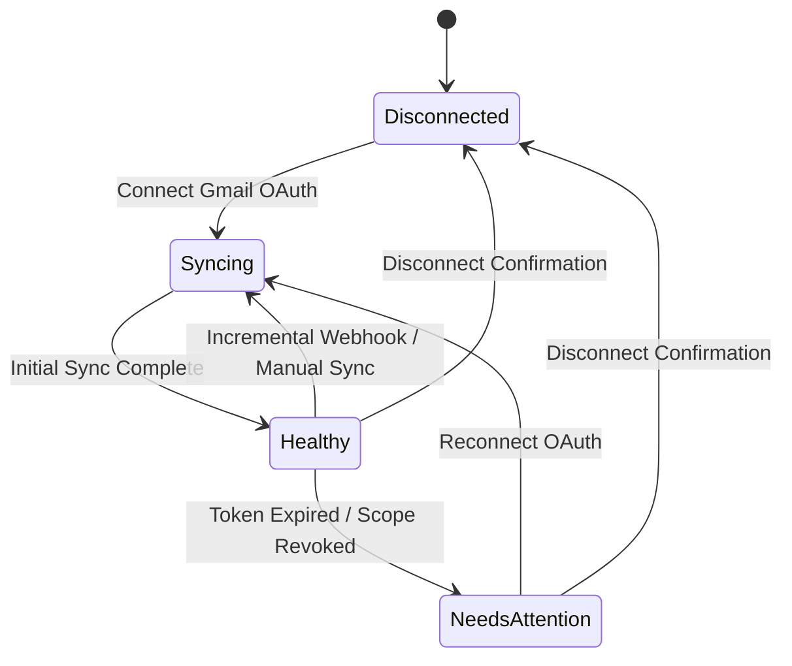

# Gmail Integration Guide

## Purpose
This document specifies the technical and operational design of the Google Workspace / Gmail integration for ProxiPilot, including multiple mailbox support, permissions, synchronization, and disconnect workflows.

---

## 1. Multiple Account Support
An organization can register and synchronize multiple Gmail mailboxes. For example, a single workspace can simultaneously monitor:
- Customer service mailbox: `support@acme.com`
- Inbound lead mailbox: `sales@acme.com`
- Escalations mailbox: `vip@acme.com`

Each connected account is managed independently with its own:
- Dedicated OAuth credentials
- Sync cursor and history
- Health & heartbeat monitor
- Disconnect & reconnect controls

---

## 2. OAuth Scopes & Permissions

ProxiPilot explicitly requests only necessary Google OAuth 2.0 scopes:

| Scope | Description | Rationale |
|---|---|---|
| `https://www.googleapis.com/auth/gmail.readonly` | Read email headers, message bodies, and attachments | Required for RAG knowledge indexing and AI message comprehension |
| `https://www.googleapis.com/auth/gmail.send` | Send outbound email messages on behalf of the user | Allows automated responses to be sent when triggered by campaigns or agent rules |
| `https://www.googleapis.com/auth/gmail.modify` | Insert labels and archive messages | Keeps mailbox organized and marks automated threads |
| `https://www.googleapis.com/auth/userinfo.email` | View primary email address | Identifies the connected integration account |

---

## 3. Account Lifecycle & Operational States

### States Defined:
- **Connected / Healthy**: Valid credentials, webhooks functioning, background sync operating normally.
- **Syncing**: Actively pulling and processing emails from Google API. Shows progressive indexing meter.
- **Needs Attention**: Refresh token expired or access was revoked in Google Account settings. User prompted to reconnect.
- **Error**: Temporary Google API rate limit (429) or operational outage.
- **Disconnected**: Connection removed. Synchronized knowledge data retained per organizational policy.

---

## 4. Disconnect & Data Retention Behavior
When an organization disconnects a Gmail account:
1. **Token Invalidation**: Server immediately revokes and purges OAuth access & refresh tokens from secure storage.
2. **Webhook Termination**: Webhook subscription on Google Cloud Pub/Sub is cancelled.
3. **Data Retention**: Existing knowledge vectors and past conversation logs are **not** abruptly deleted, ensuring business continuity. An administrator can purge historical data separately via the Knowledge settings.
