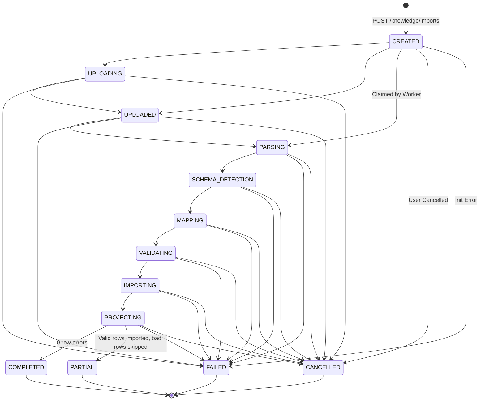

# ProxiPilot — Knowledge Import Architecture & Job Lifecycle (Phase 8.0)
============================================================
Status: IMPLEMENTED & FROZEN  
Phase: 8.0 (Knowledge Import Architecture + Async Job Lifecycle)  
Last Updated: 2026-09-17  

---

## 1. Executive Summary & Core Principle

Importing large enterprise datasets (product catalogs, pricing lists, warranty schedules, policy books) must **never block synchronous API workers**. 

ProxiPilot enforces a durable, multi-stage asynchronous import pipeline:

```
Upload Request (HTTP API)
       ↓  (Fast acknowledgment: < 100ms)
Persist Durable ImportJob (PostgreSQL)
       ↓
Publish Compact Event (Redis Streams: knowledge_import_events)
       ↓
KnowledgeImportWorker (Bounded Concurrency & Distributed Lock)
       ↓
Atomic DB Worker Claim & Heartbeat Registration
       ↓
Multi-Stage Orchestration State Machine:
   PARSING
      ↓
   SCHEMA DETECTION (Fingerprinting)
      ↓
   MAPPING (Flexible Schema Engine)
      ↓
   VALIDATING (Category Constraints)
      ↓
   IMPORTING (Bounded Atomic Batches to PostgreSQL)
      ↓
   PROJECTING (Semantic Representation & Embeddings Queue)
      ↓
COMPLETED / PARTIAL
```

### Invariant Rules:
1. **PostgreSQL as Single Source of Truth**: Redis is used solely for message transport, distributed locks, and ephemeral coordination. The durable lifecycle state, row metrics, and error summaries reside in PostgreSQL.
2. **Zero In-Memory State Reliance**: If a worker or Redis crashes, all active and abandoned jobs are fully recoverable from PostgreSQL.
3. **Strict Multi-Tenant Isolation**: Every `ImportJob` belongs to exactly one organization (`tenant_id`). No cross-tenant access, inspection, or cancellation is permitted.
4. **No Secrets or Raw Payloads in Queue**: Event payloads carry only entity identifiers and references. Raw CSV/XLSX text or binary content is never published into streams or audit logs.

---

## 2. Job States & Centralized State Machine

### 2.1 State Definitions (`ImportJobStatus`)

| Status | Category | Description |
| :--- | :--- | :--- |
| `CREATED` | Initial | Job registered in PostgreSQL and queued to Redis Streams. |
| `UPLOADING` | Ingest | Client or connector streaming payload to staging storage. |
| `UPLOADED` | Ingest | Staging complete, file reference verified. |
| `PARSING` | Pipeline | Worker extracting raw records from staged file. |
| `SCHEMA_DETECTION` | Pipeline | Profiling columns and computing schema fingerprint. |
| `MAPPING` | Pipeline | Normalizing external fields to ProxiPilot category attributes. |
| `VALIDATING` | Pipeline | Enforcing category schemas, required fields, and typed values. |
| `IMPORTING` | Pipeline | Persisting canonical KnowledgeItems, Versions, and Attributes. |
| `PROJECTING` | Pipeline | Generating semantic representations for vector projection. |
| `COMPLETED` | Terminal | Entire dataset successfully imported with 0 row errors. |
| `PARTIAL` | Terminal | Import completed with some invalid rows skipped. |
| `FAILED` | Terminal | Permanent unrecoverable failure or maximum retries exceeded. |
| `CANCELLED` | Terminal | Cleanly aborted at a stage checkpoint upon user request. |

### 2.2 Immutable State Transition Graph

State transitions are validated centrally by `VALID_JOB_TRANSITIONS`:



Attempting an invalid jump (e.g. `CREATED` $\rightarrow$ `COMPLETED`) immediately raises a `ValueError` to prevent state corruption.

---

## 3. Relational Schema & Indexes (`import_jobs`)

### 3.1 Entity Specification

| Column | Type | Constraints | Description |
| :--- | :--- | :--- | :--- |
| `id` | `VARCHAR(64)` | Primary Key (`ij_<hex>`) | Unique import job identifier. |
| `tenant_id` | `VARCHAR(64)` | Foreign Key `organizations.id` (CASCADE), NOT NULL | Owning organization boundary. |
| `source_id` | `VARCHAR(64)` | Foreign Key `knowledge_sources.id` (CASCADE), NOT NULL | Originating KnowledgeSource. |
| `dataset_name` | `VARCHAR(255)` | NOT NULL | Human-readable dataset name. |
| `file_type` | `VARCHAR(32)` | NOT NULL, Default `'csv'` | File format: `csv`, `xlsx`, `json`. |
| `file_size_bytes` | `BIGINT` | Nullable | Upload file size in bytes. |
| `file_uri` | `VARCHAR(2048)` | Nullable | Storage reference URI (never raw bytes). |
| `idempotency_key` | `VARCHAR(255)` | Nullable | Client token preventing duplicate runs. |
| `row_count` | `INTEGER` | Nullable | Total rows detected in dataset. |
| `processed_rows` | `INTEGER` | NOT NULL, Default 0 | Rows processed so far. |
| `failed_rows` | `INTEGER` | NOT NULL, Default 0 | Invalid or skipped rows. |
| `progress_percent` | `NUMERIC(5,2)` | NOT NULL, Default 0.00 | Overall completion percentage (0-100%). |
| `status` | `VARCHAR(32)` | Enum `ImportJobStatus`, NOT NULL, Default `'created'` | Current lifecycle status. |
| `current_stage` | `VARCHAR(32)` | Enum `ImportJobStage`, NOT NULL, Default `'created'` | Pipeline stage being executed. |
| `worker_id` | `VARCHAR(128)` | Nullable | Worker instance holding execution lease. |
| `last_heartbeat_at`| `TIMESTAMPTZ` | Nullable | Last keep-alive timestamp from worker. |
| `started_at` | `TIMESTAMPTZ` | Nullable | Processing start timestamp. |
| `completed_at` | `TIMESTAMPTZ` | Nullable | Processing finish timestamp. |
| `cancel_requested_at`| `TIMESTAMPTZ`| Nullable | Timestamp when cancellation was requested. |
| `retry_count` | `INTEGER` | NOT NULL, Default 0 | Number of recovery attempts. |
| `max_retries` | `INTEGER` | NOT NULL, Default 3 | Maximum allowed transient retries. |
| `error_summary` | `TEXT` | Nullable | High-level diagnostic error message. |
| `error_details_json`| `TEXT` | Nullable | Structured JSON error details. |
| `metadata_json` | `TEXT` | Nullable | Operational settings (delimiter, headers, encoding). |
| `created_by_user_id`| `VARCHAR(64)` | Foreign Key `users.id` (SET NULL), Nullable | Submitting user ID. |
| `created_at` | `TIMESTAMPTZ` | NOT NULL, Default `NOW()` | Submission timestamp in UTC. |
| `updated_at` | `TIMESTAMPTZ` | NOT NULL, Default `NOW()` | Last state modification timestamp in UTC. |

### 3.2 Performance Indexes
- `ix_import_jobs_tenant_status` on `(tenant_id, status)`: Fast filtering by organization and status.
- `ix_import_jobs_tenant_created` on `(tenant_id, created_at)`: Powers zero-OFFSET keyset pagination.
- `ix_import_jobs_tenant_source` on `(tenant_id, source_id)`: Provenance and lineage queries.
- `uq_import_jobs_tenant_idempotency` on `(tenant_id, idempotency_key)`: Database-level uniqueness preventing duplicate submissions.
- `ix_import_jobs_heartbeat_recovery` on `(status, last_heartbeat_at)`: Instant lookups for the stuck-job recovery scanner.

---

## 4. Queue Event Contract (`Redis Streams`)

### 4.1 Stream & Consumer Group Configuration
- **Stream Name**: `knowledge_import_events`
- **Consumer Group**: `knowledge-import-worker-group`
- **Event Type**: `knowledge.import.requested`

### 4.2 Universal Event Payload
```json
{
  "event_id": "evt_7f8a9b0c1d2e",
  "event_type": "knowledge.import.requested",
  "tenant_id": "org_acme_corp",
  "aggregate_type": "import_job",
  "aggregate_id": "ij_1a2b3c4d5e6f",
  "occurred_at": "2026-09-17T16:30:00.000000Z",
  "correlation_id": "req_trace_98765",
  "payload": {
    "job_id": "ij_1a2b3c4d5e6f",
    "source_id": "ks_998877665544",
    "dataset_name": "Product Master 2026",
    "file_type": "csv",
    "file_uri": "s3://proxipilot-staging/imports/product_master_2026.csv",
    "idempotency_key": "upload_idem_abc123"
  }
}
```

---

## 5. Worker Architecture & Execution Guarantees

### 5.1 Dual-Lock Job Claiming
To guarantee that multiple worker nodes or concurrent consumer tasks never execute the same job simultaneously:
1. **Redis Distributed Lock**:
   - `SET lock:import_job:{job_id} {token} EX 120 NX`
   - Released atomically via Lua script on completion or failure.
2. **Atomic PostgreSQL Claim**:
   - `SELECT ... FOR UPDATE` with lease check:
     ```sql
     UPDATE import_jobs
     SET worker_id = :worker_id,
         last_heartbeat_at = :now,
         started_at = COALESCE(started_at, :now),
         updated_at = :now
     WHERE id = :job_id
       AND status NOT IN ('completed', 'partial', 'failed', 'cancelled')
       AND (worker_id IS NULL OR last_heartbeat_at < :stale_cutoff)
     RETURNING *;
     ```

### 5.2 Heartbeat & Stuck Job Recovery
- While a job executes, the worker runs a background keep-alive task updating `last_heartbeat_at` every 5 seconds.
- If a worker crashes, the background recovery scanner (`recover_stuck_jobs`) checks for jobs in active pipeline states where `last_heartbeat_at < NOW() - 120s`.
- If `retry_count < max_retries`, the job is cleared for re-claiming by another worker node; otherwise, it is transitioned to `FAILED`.

### 5.3 Cooperative Cancellation Checkpoints
- Users or admins can request cancellation via `POST /knowledge/imports/{id}/cancel`.
- This atomically sets `cancel_requested_at = NOW()`.
- Between each pipeline stage (`PARSING`, `SCHEMA_DETECTION`, `MAPPING`, `VALIDATING`, `IMPORTING`, `PROJECTING`), the worker checks `cancel_requested_at`. If present, it halts cleanly and marks the job `CANCELLED` without leaving partially corrupted records.

### 5.4 Bounded Progress Tracking
- To avoid write amplification, progress updates are throttled (persisted at stage boundaries or every $N$ rows, rather than on every single row).

---

## 6. Multi-Tenant Security & RBAC Enforcement

- **`knowledge.create`**: Required to initiate an import job (`POST /knowledge/imports`).
- **`knowledge.read`**: Required to list import jobs or inspect progress (`GET /knowledge/imports`, `GET /knowledge/imports/{id}`).
- **`knowledge.update`**: Required to cancel an import job (`POST /knowledge/imports/{id}/cancel`).
- **Anti-Spoofing Defense**: Querying foreign organization jobs returns `404 Not Found`, preventing attackers from probing job IDs or inferring dataset activity.

---

## 7. Audit Logging

Every lifecycle milestone records an immutable audit event via `AuditService`:
- `KNOWLEDGE_IMPORT_CREATED`: Emitted upon job registration and queue dispatch.
- `KNOWLEDGE_IMPORT_STARTED`: Emitted when a worker claims the job.
- `KNOWLEDGE_IMPORT_COMPLETED`: Emitted when the pipeline finishes (`COMPLETED` or `PARTIAL`).
- `KNOWLEDGE_IMPORT_CANCELLED`: Emitted when cancellation is requested.
- `KNOWLEDGE_IMPORT_FAILED`: Emitted when an unrecoverable exception occurs.
