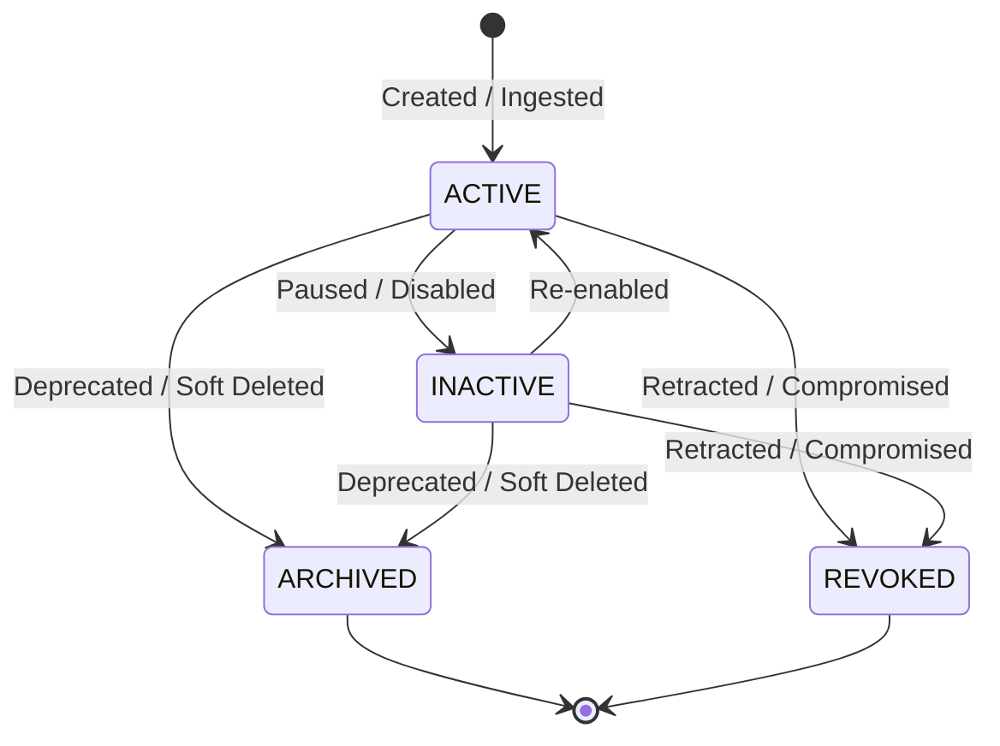

# ProxiPilot — Knowledge Sources, Lineage & Authority Architecture (Phase 7.4)
============================================================
Status: IMPLEMENTED & FROZEN  
Phase: 7.4 (Knowledge Sources, Lineage, Authority & Provenance)  
Last Updated: 2026-09-17  

---

## 1. Overview & Core Philosophy

In an enterprise RAG and autonomous AI workflow system, **untraceable information is dangerous information**. ProxiPilot requires that every knowledge fact ingested into PostgreSQL and projected into vector stores is traceable down to its origin, author, authority level, and temporal validity window:

```
ORGANIZATION (Tenant Boundary)
       ↓
KNOWLEDGE ITEM (Persistent Entity Identity)
       ↓
KNOWLEDGE VERSION (Immutable Point-in-Time Snapshot)
       ↓
KNOWLEDGE SOURCE (Provenance & Ingest Identity)
       ↓
AUTHORITY LEVEL (Truth Arbitration Hierarchy)
       ↓
EFFECTIVE PERIOD (Temporal Validity Window)
```

This ensures future AI generation (Phase 10) can answer:
1. *"Where did this information come from?"* (`pricing_q3.csv` vs direct manual dashboard entry)
2. *"Which organization owns it?"* (Strict multi-tenant isolation, anti-spoofing)
3. *"Which version is being retrieved?"* (Deterministic snapshot ID)
4. *"How authoritative is this source?"* (`ADMIN` vs `MANUAL` vs `EXTERNAL_SOURCE`)
5. *"Is this fact currently valid?"* (`effective_from <= NOW() <= effective_until`)

---

## 2. Controlled Source Types (`KnowledgeSourceType`)

ProxiPilot enforces a controlled enum domain for source types:

| Source Type | Identifier | Semantic Purpose |
| :--- | :--- | :--- |
| `manual` | `KnowledgeSourceType.MANUAL` | Hand-authored directly through dashboard UI forms. Standard default entry. |
| `csv` | `KnowledgeSourceType.CSV` | Uploaded structured comma/tab-separated tabular file. |
| `xlsx` | `KnowledgeSourceType.XLSX` | Uploaded Microsoft Excel workbook sheet. |
| `api` | `KnowledgeSourceType.API` | Pushed via external REST or webhook API integration. |
| `import` | `KnowledgeSourceType.IMPORT` | General batch import job or migrated archive. |
| `system` | `KnowledgeSourceType.SYSTEM` | Seeded automatically by system templates during tenant setup. |
| `connector` | `KnowledgeSourceType.CONNECTOR` | Continuous live sync feed from third-party connectors (Salesforce, Zendesk, HubSpot). |

---

## 3. Source Lifecycle State Machine (`KnowledgeSourceStatus`)

Every `KnowledgeSource` transitions through a controlled lifecycle:



- **`ACTIVE`**: Eligible for creating new items and versions. Retrievable in active lineage.
- **`INACTIVE`**: Temporarily suspended. Existing linked items remain readable, but no new versions may link to it.
- **`ARCHIVED`**: Superseded or soft-deleted. Historical versions remain linked for provenance, but source cannot be used for new knowledge.
- **`REVOKED`**: Retracted due to inaccuracies, breach, or legal demands. Signals retrieval pipelines that facts from this source must not be trusted.

---

## 4. Authority Model & Truth Arbitration (`SourceAuthorityLevel`)

When multiple sources provide conflicting information, ProxiPilot resolves conflicts using an explicit authority hierarchy:

| Level | Rank | Description |
| :--- | :---: | :--- |
| `system` | 1 (Highest) | Immutable system guardrails, safety policies, compliance standards. |
| `owner` | 2 | Business owner explicit overrides. |
| `admin` | 3 | Workspace organization administrator inputs. |
| `business_profile` | 4 | Canonical company facts established during onboarding. |
| `imported_data` | 5 | Bulk-uploaded operational datasets (CSV, Excel, inventory). |
| `manual` | 6 | Regular team member notes or draft knowledge entries. |
| `external_source` | 7 (Lowest) | Unverified web crawlers, third-party scrapes, or external feeds. |

---

## 5. Source ≠ Knowledge Item: Relational Lineage Model

ProxiPilot strictly differentiates the **Source** from the **Knowledge Item**:
- **Source**: E.g., `pricing_master_2026.csv` (the vehicle/file that introduced the data).
- **Knowledge Item**: E.g., `Enterprise Chiller Maintenance Plan` (the conceptual entity).

### Cardinality & Relationships
- **One Source → Many Knowledge Items**: A single uploaded CSV source can generate hundreds of individual knowledge items.
- **One Knowledge Item → Many Versions across Different Sources**: Over time, an item's Version 1 may come from `direct_manual`, Version 2 from `pricing_v2.csv`, and Version 3 from `salesforce_api`.
- **Lineage Integrity**: Updating or archiving a source NEVER alters historical `KnowledgeVersion.source_id` pointers. Historical audit trails remain permanently immutable.

---

## 6. Temporal Semantics: Source vs Knowledge Item Validity

Temporal attributes are strictly partitioned by concern:
1. **Source Temporal Validity (`effective_from`, `effective_until` on `KnowledgeSource`)**:
   - Represents the time period during which the *source dataset* is authorized for operational use.
   - Example: A promotional seasonal catalog uploaded on August 15 may have `effective_from = "2026-09-01"` and `effective_until = "2026-09-30"`.
2. **Item/Version Validity (`effective_from`, `effective_until` on `KnowledgeVersion`)**:
   - Represents when the specific *business fact* is in effect.
   - Separate from upload date (`created_at`).

---

## 7. Multi-Tenant Isolation & Anti-Spoofing Defense

ProxiPilot enforces hard tenant boundaries at the database and service layers:

1. **Strict Query Scoping**: Every query filters on `KnowledgeSource.tenant_id == current_tenant_id`. No unscoped queries are permitted.
2. **Anti-Spoofing Lineage Validation**:
   - When creating or updating a knowledge item with `source_id`, the service verifies that `source.tenant_id == tenant_id`.
   - If Organization B references Organization A's `source_id`, the system returns `404 Not Found` (refusing to leak the existence or metadata of foreign sources).
3. **Cross-Tenant IDOR Protection**:
   - GET, PATCH, DELETE, and Lineage routes for `knowledge/sources/{id}` return `404 Not Found` if accessed by a different organization.

---

## 8. Deterministic Source Deduplication Strategy

To avoid redundant source records when uploading identical datasets:
1. **Cryptographic Checksum (`SHA-256`)**:
   - Client or ingestion pipelines supply a SHA-256 `checksum` of the raw payload.
   - If an `ACTIVE` source exists for `(tenant_id, checksum)`, ProxiPilot reuses the existing `KnowledgeSource` row instead of creating a duplicate.
2. **External Reference Key (`source_type + source_reference`)**:
   - Connectors and API feeds provide a stable `source_reference` (e.g., connector job ID).
   - Lookups verify `(tenant_id, source_type, source_reference)` to reuse active identities.

---

## 9. API Specifications & Contracts

### 9.1 Routes
All endpoints require authentication and active tenant context:

- `POST   /api/v1/knowledge/sources`
  - Creates or deduplicates a source.
  - Requires permission: `knowledge.create`.
- `GET    /api/v1/knowledge/sources`
  - Lists sources using keyset cursor pagination (`created_at DESC, id DESC`).
  - Supports filters: `source_type`, `status`, `authority_level`.
  - Requires permission: `knowledge.read`.
- `GET    /api/v1/knowledge/sources/{id}`
  - Fetches source metadata and aggregate linked item/version counts.
  - Requires permission: `knowledge.read`.
- `PATCH  /api/v1/knowledge/sources/{id}`
  - Updates source metadata, temporal validity, or authority level.
  - Requires permission: `knowledge.update`.
- `DELETE /api/v1/knowledge/sources/{id}`
  - Soft-archives (`?revoke=false`) or revokes (`?revoke=true`) the source.
  - Requires permission: `knowledge.delete`.
- `GET    /api/v1/knowledge/sources/{id}/lineage`
  - Traverses complete provenance tree: Source → Linked Items → Historical Versions.
  - Requires permission: `knowledge.read`.

### 9.2 Zero-OFFSET Keyset Cursor Pagination
Pagination uses opaque Base64 tokens encoding `(created_at, id)`:
```
cursor = base64_url_encode("{iso_datetime}|{item_id}")
```
Guarantees $O(1)$ database query performance regardless of page depth without table drift or offset skips.

---

## 10. Audit Logging & Security Rules

All source lifecycle transitions emit structured audit events via `AuditService`:
- `KNOWLEDGE_SOURCE_CREATED`
- `KNOWLEDGE_SOURCE_UPDATED`
- `KNOWLEDGE_SOURCE_ARCHIVED`
- `KNOWLEDGE_SOURCE_REVOKED`

### Security Guarantees:
- **No Raw Payloads**: Full CSV/XLSX text or binary content is NEVER stored in `knowledge_sources` or audit tables.
- **No Secrets**: OAuth tokens, credentials, and API secrets are strictly scrubbed by `sanitize_audit_metadata`.
- **Atomic Commits**: Audit events and business entity state mutations commit within the exact same database transaction.

---

## 11. Future Retrieval & RAG Safety (Phase 10 Grounding Contract)

During Phase 10 vector embedding and RAG retrieval, each chunk and citation will carry this immutable lineage payload:

```json
{
  "chunk_id": "chk_9a8b7c",
  "knowledge_item_id": "ki_07ca1e7f577445f6",
  "knowledge_version_id": "kv_88df2a4c11e94b21",
  "version_number": 2,
  "tenant_id": "org_enterprise_corp",
  "source_id": "ks_6a66bfe02e4d429d",
  "source_name": "HVAC Service Catalog Q3",
  "source_type": "csv",
  "authority_level": "admin",
  "effective_from": "2026-09-01T00:00:00Z",
  "effective_until": "2026-12-31T23:59:59Z"
}
```

This guarantees evidence-aware retrieval, enabling autonomous AI agents to prioritize verified admin sources over unverified web data while discarding expired facts.
