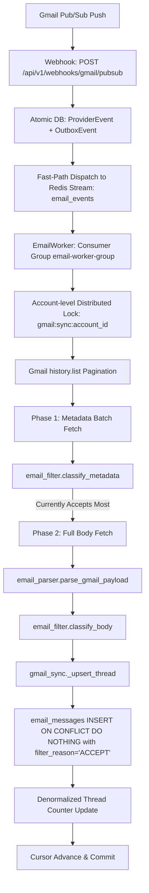

# PROXIPILOT — PHASE 10.1
# Implementation Assessment & Architecture Audit

**Target:** Enterprise Conversation Context Resolver, Thread State Management & Pre-Persistence Email Relevance Filtering  
**Date:** October 19, 2026  
**Status:** Audit Complete — Ready for Implementation  

---

## 1. Current Message Lifecycle



1. **Pub/Sub Ingress:** Authenticated webhook accepts push, commits `ProviderEvent` and `OutboxEvent` atomically, and acknowledges Google with HTTP 200.
2. **Queue Delivery:** Outbox relays `gmail.mailbox_change` to Redis Stream `email_events`.
3. **Synchronization Worker:** `EmailWorker` acquires per-account lock `gmail:sync:{account_id}`, applies Lua high-watermark coalescing, and paginates `history.list`.
4. **Metadata Filtering (Phase 1):** Fetches metadata headers (`From`, `To`, `Subject`, `List-*`, `Precedence`). Currently runs `classify_metadata`.
5. **Full Body Fetch (Phase 2):** For accepted message IDs, fetches complete MIME payload, parses with `email_parser`, and calls `_normalize_and_store`.
6. **Thread Upsert & Message Insert:** Unconditionally upserts `EmailThread`, inserts into `email_messages` with `filter_reason="ACCEPT"`, and advances the sync cursor.

---

## 2. Root Cause: Exact Locations Causing Unwanted Persistence

An inspection of the 38 real messages in `email_messages` reveals that **100% of messages had `filter_reason: ACCEPT`**, including:
- LinkedIn and Indeed job alert digests
- Quora digests
- Neon changelog newsletters
- ProPeers webinar, launch, and hiring promotional campaigns
- Grok usage-reset notices
- Shiprocket delivery status updates
- Bank of Baroda e-statements and UPI notices
- Heroku MFA security reminders
- Rentok payment receipts

### Root Cause 1: Score Reset Between Metadata and Body Stages
In `server/app/services/email_filter.py`:
- `classify_metadata` sets `_PROMO_SCORE_THRESHOLD = 60`. A promotional email with `List-Unsubscribe` gets 35 points (below 60), passing Stage 1 as `ACCEPT`.
- In `classify_body` (line 415), a **brand new `FilterScore()` is initialized (`score = FilterScore()`)**! The 35 points earned in metadata scoring are completely wiped out.
- In `classify_body`, if the body has 1 or 2 footer phrases ("unsubscribe", "manage preferences"), it receives only 8 to 20 points, which is below `_BODY_SCORE_THRESHOLD = 25`. Thus, `classify_body` returns `ACCEPT`.

### Root Cause 2: Hardcoded `filter_reason="ACCEPT"` at Database Write
In `server/app/services/gmail_sync.py` (line 874):
```python
msg_insert = pg_insert(EmailMessage).values(
    ...
    filter_reason=FilterDecision.ACCEPT.value,  # ← Hardcoded for all stored rows!
    ...
)
```
The system lacked an explicit classification category (`BUSINESS_CONVERSATION`, `PROMOTIONAL_BULK`, etc.) and mapped every non-blocked row to `ACCEPT`.

### Root Cause 3: Premature `EmailThread` Upsert
In `server/app/services/gmail_sync.py` (lines 824–835):
`_upsert_thread` was invoked **before** message insertion and before the final persistence gate. Even when an email was rejected at the body stage, an `EmailThread` row with its subject and snippet had already been inserted into the database!

### Root Cause 4: Rigid Domain Allow/Deny Lists Without Category Separation
`_TRANSACTIONAL_NOTIFICATION_DOMAINS` relied on an exact hardcoded list of domains, missing obvious patterns such as `propeers.in`, `grok-bot@mail.cursor.com`, `bankofbaroda.bank.in`, `notifications.heroku.com`, and `rentok.com`. Furthermore, there was no category separation distinguishing `PROMOTIONAL_BULK`, `NON_CONVERSATIONAL_NOTIFICATION`, and `SECURITY_OR_FINANCIAL_NOTICE`.

---

## 3. Reusable Existing Components

1. **`EmailParser` (`server/app/services/email_parser.py`):**
   Robust MIME parsing: extracts sender, recipients, normalized subject (`Re:`/`Fwd:` stripped), body text, threading headers (`Message-ID`, `In-Reply-To`, `References`), and attachment metadata.
2. **`DistributedLock` (`server/app/services/gmail_sync.py`):**
   Redis distributed lock with UUIDv4 token and atomic Lua release (`RELEASE_LUA`).
3. **`OutboxService` (`server/app/services/outbox.py`):**
   Transactional outbox for guaranteed, atomic event publication from PostgreSQL to Redis Streams.
4. **`DomainEvent` & `EventBus` (`server/app/core/messaging.py`):**
   Standardized immutable event envelopes for Redis Streams.
5. **Existing PostgreSQL Models (`server/app/models/inbox.py`):**
   `EmailThread` and `EmailMessage` with tenant foreign keys, composite indexes (`ix_email_messages_tenant_thread_sent`), and unique constraints.

---

## 4. Missing Capabilities & Justified Schema Migrations

### A. Missing Capabilities
1. **Multi-Signal Classification Engine:**
   - 7 explicit categories: `BUSINESS_CONVERSATION`, `PROMOTIONAL_BULK`, `NON_CONVERSATIONAL_NOTIFICATION`, `SECURITY_OR_FINANCIAL_NOTICE`, `AUTOMATED_REPLY`, `SUSPICIOUS_OR_SPAM`, `AMBIGUOUS`.
   - 4 explicit dispositions: `STORE_AND_RESOLVE_CONTEXT`, `SUPPRESS_BEFORE_EMAIL_PERSISTENCE`, `STORE_WITHOUT_CONVERSATION_PROCESSING`, `REVIEW_OR_HOLD`.
   - Accumulated scoring pipeline where header signals persist into body classification.
   - Protection for human conversations, short human greetings ("Hyyy", "Helloooooooo"), and inquiries ("Need catalogue and price list").
2. **Pre-Persistence Suppression Gate:**
   - Suppressed emails are completely excluded from `email_messages` and never create phantom `EmailThread` rows.
   - Fast, durable suppression bookkeeping guarantees cursor advancement without storage waste.
3. **Conversation Context Resolver:**
   - Structured context envelope containing: Identity & Tracing, Current Message, Bounded Chronological Prior Messages (default 10), Incremental Thread Summary, and Structured Unresolved Requirements.
   - Per-thread serialization via distributed lock (`email:thread_lock:{tenant_id}:{thread_id}`).
   - Optimistic revision checking on `EmailThread` (`context_revision`).

### B. Justified Schema Migration on `email_threads`
To store versioned thread summaries, optimistic revision counters, and structured unresolved requirements without creating unnecessary separate tables:
- `context_revision: Integer, default=1, nullable=False`
- `unresolved_requirements: Text (JSON array), nullable=True`
- `summary_metadata: Text (JSON object), nullable=True`

---

## 5. Planned Changes & Acceptance Test Plan

1. **Step 1: Database Migration:**
   Create Alembic migration adding `context_revision`, `unresolved_requirements`, and `summary_metadata` to `email_threads`.
2. **Step 2: Upgrade Email Filter Service (`email_filter.py`):**
   Implement categories, dispositions, accumulated multi-signal scoring, and golden dataset rules.
3. **Step 3: Refactor Gmail Ingestion (`gmail_sync.py`):**
   Run the pre-persistence gate before `_upsert_thread` and before `email_messages` insertion. If suppressed, skip storage entirely. If accepted, persist and dispatch context resolution event via outbox.
4. **Step 4: Implement Conversation Context Resolver (`context_resolver.py`):**
   Build context envelope builder, bounded chronological query, structured requirements extractor/tracker, and optimistic thread state updates.
5. **Step 5: Automated Test Suite:**
   - Golden regression tests on the 38 real messages.
   - Multi-tenant cross-tenant isolation tests.
   - Concurrency & optimistic locking tests.
   - 10,000-candidate one-second burst benchmark.
